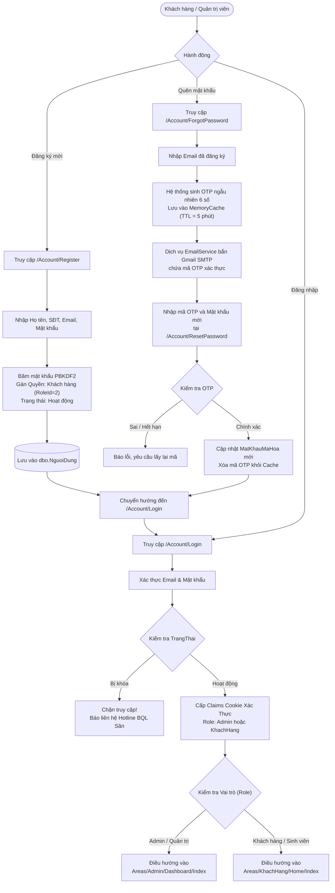
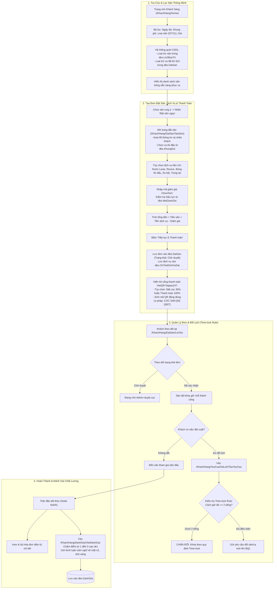
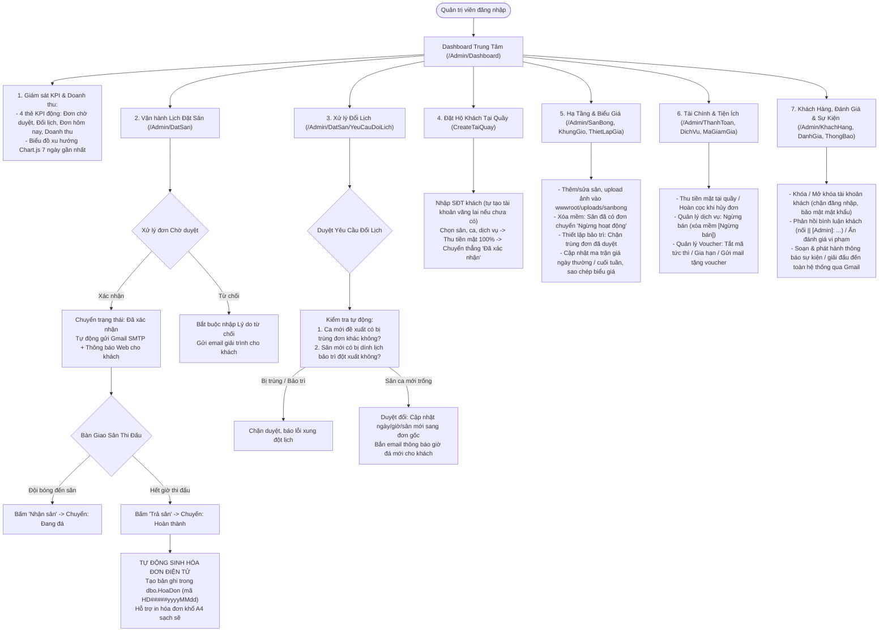
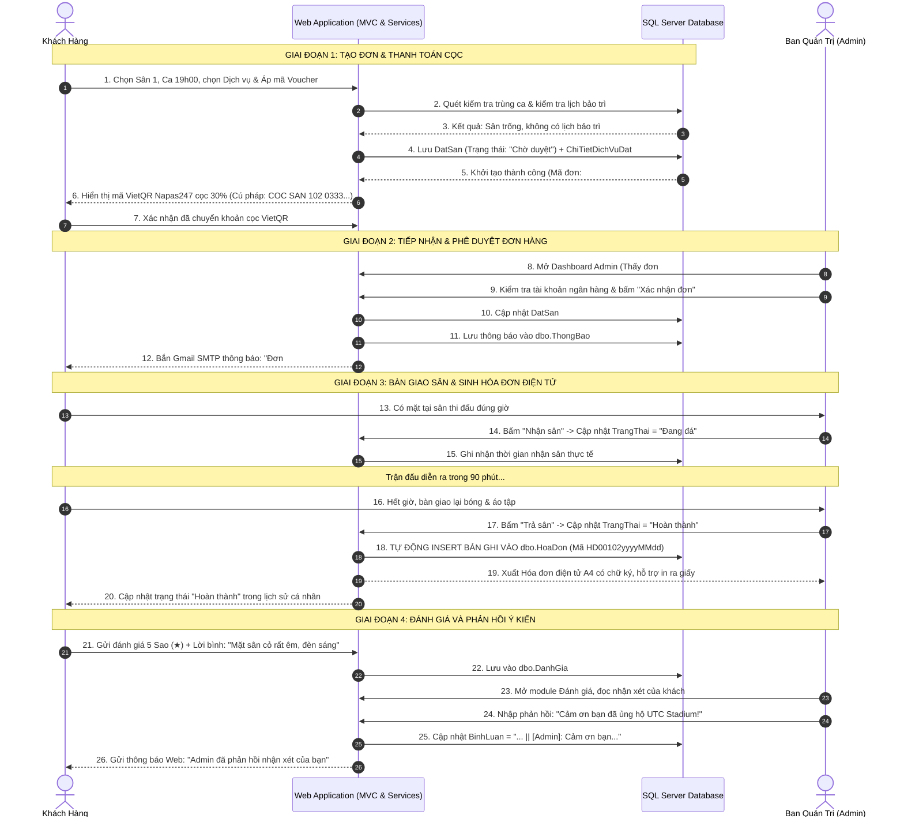

# HỆ THỐNG QUẢN LÝ SÂN BÓNG ĐÁ "UTC STADIUM"
## ĐẶC TẢ SƠ ĐỒ KIẾN TRÚC & LUỒNG HOẠT ĐỘNG TOÀN HỆ THỐNG
*(SYSTEM WORKFLOW & USER JOURNEY SPECIFICATION)*

---

> [!NOTE]
> **Thông tin dự án:**
> - **Tên hệ thống:** UTC STADIUM - Cổng Thông Tin & Quản Lý Đặt Sân Bóng Đá Sinh Viên
> - **Nền tảng công nghệ:** ASP.NET Core MVC (.NET 8), Entity Framework Core, SQL Server, Chart.js, Bootstrap 5
> - **Mô hình kiến trúc:** Area-based MVC (`Areas/KhachHang`, `Areas/Admin`, Core Controllers & Services)

---

## MỤC LỤC TỔNG QUAN

1. [PHẦN 1: TỔNG QUAN LUỒNG XÁC THỰC & ĐIỀU HƯỚNG PHÂN QUYỀN (AUTH & RBAC FLOW)](#phần-1-tổng-quan-luồng-xác-thực--điều-hướng-phân-quyền-auth--rbac-flow)
2. [PHẦN 2: LUỒNG HOẠT ĐỘNG PHÂN HỆ KHÁCH HÀNG (AREAS/KHACHHANG)](#phần-2-luồng-hoạt-động-phân-hệ-khách-hàng-areaskhachhang)
3. [PHẦN 3: LUỒNG HOẠT ĐỘNG PHÂN HỆ QUẢN TRỊ ADMIN (AREAS/ADMIN)](#phần-3-luồng-hoạt-động-phân-hệ-quản-trị-admin-areasadmin)
4. [PHẦN 4: SƠ ĐỒ TUẦN TỰ E2E TƯƠNG TÁC TOÀN HỆ THỐNG (MERMAID SEQUENCE DIAGRAM)](#phần-4-sơ-đồ-tuần-tự-e2e-tương-tác-toàn-hệ-thống-mermaid-sequence-diagram)
5. [PHẦN 5: BẢNG MA TRẬN GIẢI PHÁP KỸ THUẬT NỔI BẬT](#phần-5-bảng-ma-trận-giải-pháp-kỹ-thuật-nổi-bật)

---

## PHẦN 1: TỔNG QUAN LUỒNG XÁC THỰC & ĐIỀU HƯỚNG PHÂN QUYỀN (AUTH & RBAC FLOW)

Hệ thống xác thực của UTC STADIUM được xây dựng trên nền tảng **Cookie Authentication & ASP.NET Core Claims Identity**, kết hợp mã hóa một chiều bằng thuật toán `PasswordHasher<NguoiDung>` (PBKDF2 HMAC-SHA256 có Salt ngẫu nhiên).

### Chi Tiết Kỹ Thuật:
1. **Đăng ký tài khoản (`/Account/Register`)**: Khách hàng nhập thông tin. Mật khẩu được băm bảo mật bằng `PasswordHasher<NguoiDung>`, gán vai trò mặc định `"Khách hàng"`, trạng thái `"Hoạt động"`.
2. **Khôi phục mật khẩu qua Gmail OTP**: Hệ thống sinh mã OTP 6 số ngẫu nhiên qua `RandomNumberGenerator`, lưu đệm trong `MemoryCache` trong vòng **5 phút** (không cần tạo thêm cột trong DB) và bắn qua Gmail SMTP. Khách xác thực thành công sẽ được cấp quyền cập nhật mật khẩu mới.
3. **Đăng nhập & Điều hướng thông minh**:
   - Tài khoản có cờ `TrangThai == "Bị khóa"` sẽ bị chặn ngay lập tức kèm thông báo hotline hỗ trợ.
   - Nếu đăng nhập thành công, hệ thống kiểm tra Claim `Role`:
     - **Admin**: Điều hướng thẳng vào `Areas/Admin/Dashboard/Index`.
     - **Khách hàng**: Trả về `Areas/KhachHang/Home/Index` hoặc trang đặt sân trước đó (`ReturnUrl`).

---

## PHẦN 2: LUỒNG HOẠT ĐỘNG PHÂN HỆ KHÁCH HÀNG (`AREAS/KHACHHANG`)

Quy trình trải nghiệm người dùng (User Journey) từ lúc tìm kiếm sân đến khi hoàn tất trận đấu và để lại đánh giá:

---

## PHẦN 3: LUỒNG HOẠT ĐỘNG PHÂN HỆ QUẢN TRỊ ADMIN (`AREAS/ADMIN`)

Phân hệ Admin phụ trách toàn diện công tác **Vận hành sân cỏ - Giám sát dòng tiền - Điều phối lịch thi đấu - Chăm sóc khách hàng**:

---

## PHẦN 4: SƠ ĐỒ TUẦN TỰ E2E TƯƠNG TÁC TOÀN HỆ THỐNG (MERMAID SEQUENCE DIAGRAM)

Sơ đồ thể hiện trực quan tương tác giữa 4 thực thể: **Khách hàng** $\leftrightarrow$ **Web Controller / Services** $\leftrightarrow$ **SQL Server Database** $\leftrightarrow$ **Quản trị viên (Admin)**:

---

## PHẦN 5: BẢNG MA TRẬN GIẢI PHÁP KỸ THUẬT NỔI BẬT

| Hạng mục kỹ thuật | Giải pháp triển khai trong dự án UTC STADIUM | Giá trị thực tiễn khi bảo vệ đồ án |
| :--- | :--- | :--- |
| **Bảo toàn CSDL (Schema Integrity)** | Tuyệt đối không chỉnh sửa cấu trúc `Models/Entities/` gốc. Mọi logic mới giải quyết bằng ViewModel và tiền tố nghiệp vụ. | Chứng minh năng lực làm việc trên hệ thống kế thừa (Legacy Code) mà không gây rủi ro đứt gãy hệ thống. |
| **Xóa mềm chống lỗi Khóa ngoại** | Áp dụng tiền tố `[Ngừng bán]` cho Dịch vụ và cờ `Ngừng hoạt động` cho Sân bóng thay vì xóa cứng khỏi SQL. | Triệt tiêu 100% lỗi `SqlException: Foreign Key Constraint Violation`, bảo toàn dữ liệu kế toán và hóa đơn cũ. |
| **Quy tắc Time-lock Rule** | Chặn hủy và đổi lịch trước giờ thi đấu dưới 2 tiếng trên cả Client (JavaScript) lẫn Server (Controller validation). | Đảm bảo tính công bằng thương mại, bảo vệ doanh thu cụm sân, ngăn chặn hành vi đặt ảo / bùng sân phút chót. |
| **Bàn giao sân & Sinh Hóa đơn** | Luồng 1 chiều `Chờ duyệt` $\rightarrow$ `Đã xác nhận` $\rightarrow$ `Đang đá` $\rightarrow$ `Hoàn thành` tự sinh `dbo.HoaDon`. | Khép kín chu trình kế toán quản trị chuyên nghiệp, tự động hóa toàn bộ khâu xuất hóa đơn thanh toán. |
| **Truyền thông đa kênh (Multi-channel)** | Tích hợp song song thông báo hòm thư Web (`dbo.ThongBao`) và bắn email HTML chuẩn Gmail qua giao thức SMTP. | Nâng cao trải nghiệm người dùng, đảm bảo khách hàng nhận thông tin tức thì ngay cả khi không mở website. |

---
*Tài liệu được khởi tạo và đóng gói tự động bởi Antigravity System Architect.*

